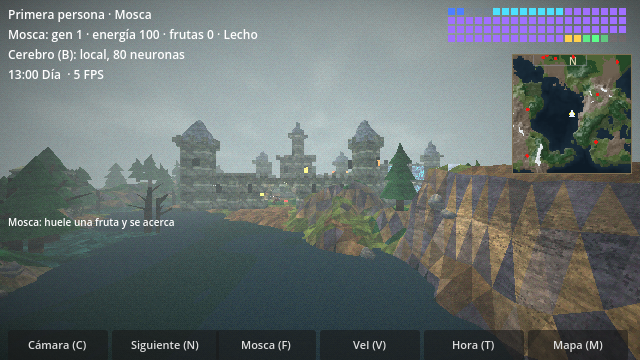

# Nocturnia

Un mundo de fantasía oscura con estética PlayStation 1, hecho en **Godot 4.7** (GDScript, renderer de compatibilidad), poblado por aldeanos, caballeros, un culto y monstruos con inteligencia propia… y por una **mosca de la fruta** que explora el mapa guiada por el **conectoma real de *Drosophila*** (FlyWire, 138.639 neuronas) simulado en un servidor Python.



## Qué contiene

| Carpeta | Contenido |
|---|---|
| [`game/`](game) | Proyecto de Godot 4.7: mundo, mobs, mosca, cerebros, shaders, interfaz y pruebas |
| [`brain_server/`](brain_server) | Servidor Python con el conectoma de FlyWire (simulador LIF compilado con numba). **Imprescindible**: es el único cerebro de la mosca |
| [`blender/`](blender) | Scripts de Blender (bpy) que generaron los personajes `.glb` y sus animaciones |
| [`docs/`](docs) | Documentación técnica detallada |

## Inicio rápido

1. Instala [Godot 4.7](https://godotengine.org/) (el proyecto declara `config/features = 4.7`; se probó también en 4.3).
2. Arranca el **servidor del cerebro** (la mosca no se mueve sin él):

```bash
cd brain_server
pip install -r requirements.txt      # Python 3.10+, numba, numpy, scipy, pandas, pyarrow
sh descargar_datos.sh                # (descargar_datos.bat en Windows) ~370 MB, una sola vez
sh iniciar.sh                        # (iniciar.bat en Windows)  ->  "Cerebro listo: 138639 neuronas"
```

3. Abre la carpeta `game/` en Godot (la primera vez importa los recursos; así se registran los `class_name` y se generan los `.uid`) y pulsa **F5**.

El juego se conecta solo al puerto 9009. Mientras no haya servidor, la mosca espera quieta (sin hambre) y el HUD dice `SIN SERVIDOR`; se reintenta la conexión cada 3 s. Tras conectar, el cerebro tarda unos segundos en responder por primera vez. Detalles en [`brain_server/README.md`](brain_server/README.md).

## Controles

| Tecla | Acción |
|---|---|
| **C** | Cámara: primera persona → tercera persona → cámara libre |
| **N** / **F** | Siguiente ser a seguir / volver a la mosca |
| **V** | Velocidad de simulación ×1 / ×3 / ×8 |
| **T** / **Y** | Salta a la siguiente hora del día / paso automático del tiempo |
| **R** | Enciende o apaga la lluvia |
| **M** | Mapa completo (clic = la cámara libre viaja ahí) |
| **F11** | Pantalla completa |
| Cámara libre | **WASD** mover, **Q/E** bajar/subir, **Shift** ×4, **Ctrl** ×0,25, rueda = velocidad, arrastrar = mirar |

## La mosca en pocas líneas

- **Sentidos:** dos antenas que comparan el olor de las frutas, detectores de amenaza (*looming*) a izquierda y derecha para mobs y hechizos, y hambre. El olor **no atraviesa muros**.
- **Cerebro:** el conectoma real de FlyWire, a través de `brain_server/`. Ver [`docs/CEREBRO.md`](docs/CEREBRO.md).
- **Dolor y aprendizaje:** si choca con una pared siente dolor, retrocede y aprende a temerlas mediante unos «bigotes» (rayos hacia delante). El aprendizaje vive en las entradas del cerebro, no en el conectoma.
- **Simetría:** el cerebro real se «espeja» periódicamente para que gire parejo a izquierda y derecha.
- **Hambre:** aguanta unos 220 s sin comer; al morir renace y conserva lo aprendido.
- **Registro en pantalla:** solo muestra lo que hace la mosca (olfatea, huye, tiene hambre, choca, come, muere).

## Documentación

- [`docs/ARQUITECTURA.md`](docs/ARQUITECTURA.md): cómo está organizado el código, el mundo, los mobs y el render.
- [`docs/CEREBRO.md`](docs/CEREBRO.md): conectoma real, protocolo cliente-servidor, dolor, aprendizaje y simetría.
- [`docs/RENDIMIENTO.md`](docs/RENDIMIENTO.md): de 2 a 165 FPS, LOD de mobs y límites de física.
- [`docs/PRUEBAS.md`](docs/PRUEBAS.md): metodología de pruebas, cómo ejecutarlas y resultados.
- [`docs/HISTORIAL.md`](docs/HISTORIAL.md): todo lo que se hizo, en orden, con el porqué de cada decisión.
- [`blender/README.md`](blender/README.md): generación de personajes y animaciones.
- [`docs/README_ORIGINAL_DEL_PROYECTO.md`](docs/README_ORIGINAL_DEL_PROYECTO.md): el README histórico del proyecto (texturas, mobs, post-proceso; menciona el cerebro local, ya eliminado).

## Limitaciones conocidas

- **Sin servidor no hay mosca activa:** el cerebro local de 80 neuronas se eliminó; el juego exige el servidor del conectoma (necesita Python, numba y ~370 MB de datos).
- El conectoma real tiene pesos fijos: **no aprende**. El aprendizaje por dolor está en la entrada del cerebro, no dentro del conectoma.
- El giro del cerebro real lo produce un **lector que se entrenó con el propio conectoma** (no un circuito motor conocido), y corre a ~0,7× el tiempo real en un solo núcleo.
- El rendimiento se midió sin GPU (renderizado por software y modo *headless*); los FPS reales dependen de tu equipo.
- La mayoría de las pruebas de comportamiento son estadísticas con pocas semillas: dan orden de magnitud, no cifras exactas.

## Créditos y licencias

- Conectoma: **FlyWire** (*Drosophila melanogaster*, versión 783). Parámetros del modelo LIF de Shiu et al. (2023). Revisa los términos de uso y la atribución de los datos antes de redistribuirlos: el repositorio **no** incluye los datos, los descarga `descargar_datos.sh`.
- Motor: [Godot Engine](https://godotengine.org/) (licencia MIT).
- Texturas, modelos y scripts de este repositorio: generados por código para el proyecto.
- **Licencia del código: pendiente de elegir** (añade un archivo `LICENSE`; por ejemplo MIT si quieres que sea libre).
