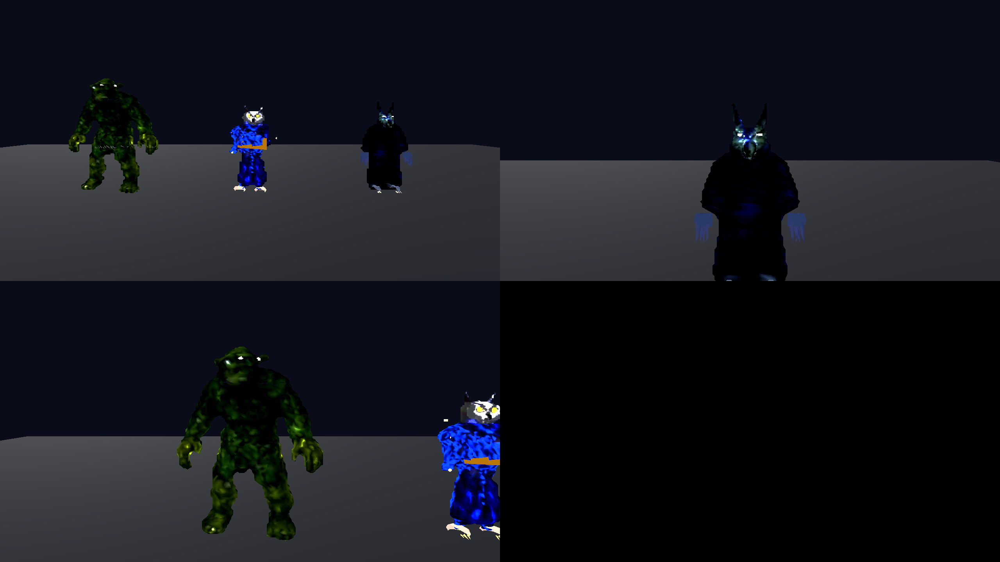
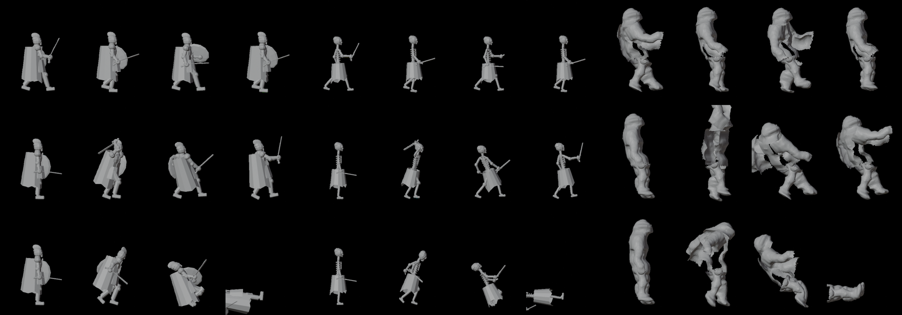

# Los personajes

Esta carpeta guarda **las recetas con las que se crearon los personajes en 3D** del juego. Están hechos con [Blender](https://www.blender.org/), un programa gratuito de modelado 3D.



## ¿Qué son estas «recetas»?

Ningún personaje se esculpió a mano. Cada uno sale de un pequeño programa (un *script*) que le dice a Blender, paso a paso, cómo construirlo:

1. **Da forma al cuerpo**, con su cabeza, brazos, piernas, ropa y armas.
2. **Lo pinta** con colores sucios y gastados, al estilo de los juegos antiguos.
3. **Le pone un esqueleto** de huesos invisibles para poder moverlo.
4. **Le crea las animaciones:** estar de pie respirando, caminar, atacar, recibir un golpe y caer muerto.
5. **Lo guarda** en un archivo que el juego puede usar.

La ventaja es que, si se quiere cambiar algo (por ejemplo, que todos los caballeros sean más altos), basta con tocar la receta y volver a generarlos.



## Qué personajes hay

**Los protagonistas,** hechos a partir de un dibujo de referencia:
- El **lobo hechicero** (`wolf_ref.py`)
- El **mago búho** (`owl_ref.py`)
- El **troll de colina** (`troll_ref.py`)

**Los habitantes del mundo:**
- **Aldeanos** (`mob_human.py`), en tres versiones
- **Caballeros** (`mob_knight.py`)
- **Duendes** (`mob_goblin.py`), en dos versiones
- **Hombre cabra** (`mob_goat.py`)
- **Esqueleto** (`mob_skeleton.py`)
- **Necrófago** (`mob_ghoul.py`)
- **Espectro** (`mob_wraith.py`)
- **Médico de la peste** (`mob_plague.py`)

**Las herramientas comunes**, que comparten todas las recetas:
- `mobgen.py` y `charlib.py` tienen las piezas básicas: cuerpos, esqueletos y animaciones.
- `reanimate.py` añade codos, rodillas y pies a los personajes antiguos para que se muevan mejor.
- `posepreview.py` saca fotos rápidas de las poses para revisarlas.

## ¿Necesito esto para jugar?

**No.** Los personajes ya están creados y guardados dentro del juego, en `game/assets/models/`. Esta carpeta solo hace falta si quieres modificarlos o crear personajes nuevos.

## Si quieres regenerarlos

Necesitas Blender 4 o más nuevo, o Python con el paquete `bpy`. Antes de ejecutar las recetas, cambia dentro de ellas la carpeta donde se guardan los resultados (la variable `OUT` de `mobgen.py` y las rutas de los otros scripts) por una de tu ordenador. Después, por ejemplo:

```bash
python mob_knight.py
```

Los detalles técnicos están en [`docs/PERSONAJES_BLENDER.md`](../docs/PERSONAJES_BLENDER.md).
