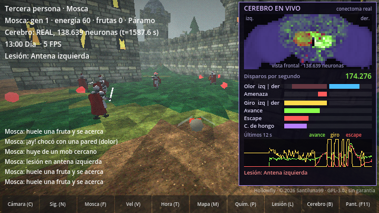

# Cerebro en vivo y lesiones

Dos herramientas para ver qué hace el **cerebro real** (conectoma FlyWire, 138.639 neuronas) mientras la mosca decide, y qué pasa cuando se le apaga una parte.

> **Es una simulación.** El panel muestra la actividad del modelo del cerebro que corre en `brain_server/`, no una grabación de una mosca viva. Las lesiones enseñan qué deja de funcionar *en este modelo*; coinciden con lo que se espera de la anatomía, pero no son un experimento real.

## Cerebro en vivo (tecla B)

Pulsa **B** (o el botón *Cerebro (B)*). El panel ocupa el lado derecho, en el sitio del minimapa, y se quita con la misma tecla.

| Parte | Qué muestra |
|---|---|
| Mapa | El cerebro visto de frente. Cada casilla agrupa las neuronas que están ahí de verdad (posición de cada neurona en FlyWire). Los dos bultos de los lados son los lóbulos ópticos; el centro es el cerebro central. El brillo verde es la actividad en ese instante; en rojo, las casillas con neuronas lesionadas. |
| Disparos por segundo | Cuántos impulsos emiten las 138.639 neuronas en total. En reposo, sin olor ni amenaza, es 0: este modelo no tiene actividad espontánea. |
| Olor, Amenaza | Lo que siente la mosca a cada lado. Si ese sentido está lesionado, la barra se pinta apagada: el estímulo está ahí, pero no entra. |
| Giro, Avance, Escape | Las órdenes que salen del cerebro. *Giro* es la orden del cerebro, antes de sumarle el deambular al azar que añade el juego. |
| C. de hongo | Parte de las células de Kenyon (cuerpos de hongo, memoria olfativa) que están activas. |
| Últimos 12 s | Avance, giro y escape en el tiempo, para ver la reacción a un estímulo. |

Para grabar un video conviene capturar la pantalla con el juego en tiempo real. El modo de grabación de Godot (`--write-movie`) desincroniza el cerebro.

## Lesiones (tecla L)

Pulsa **L** (o el botón *Lesión (L)*), marca uno o varios grupos y pulsa **Aplicar**. **Restaurar cerebro** las quita todas. El HUD y el panel del cerebro muestran qué lesión hay.

Una lesión **silencia** un grupo de neuronas: no pueden disparar. No se cambia ninguna conexión, así que al restaurar el cerebro queda exactamente como antes. Mientras hay una lesión la mosca no aprende (igual que con los compuestos), y si muere renace sana.

| En pantalla | Qué se apaga | Neuronas | Qué se observa |
|---|---|---|---|
| Antena izquierda / derecha | Neuronas olfativas de esa antena | 1.116 / 1.133 | Solo huele por un lado y gira hacia el lado sano, aunque la fruta esté al otro |
| Relevo olfativo | Neuronas de proyección del lóbulo antenal | 685 | El olor llega a las antenas pero no pasa al resto del cerebro: no reacciona a la fruta |
| Amenaza izquierda / derecha | Detectores de aproximación (LPLC2) de ese lado | 108 / 102 | No ve lo que se le acerca por ese lado: ni gira ni escapa |
| Fibra gigante | Las 2 neuronas del escape rápido (DNp01) | 2 | Sigue girando para huir, pero la señal de escape desaparece y avanza algo menos |
| Cuerpos de hongo | Células de Kenyon | 5.177 | La conducta innata (ir al olor, huir) sigue igual |
| Complejo central | Neuronas del complejo central | 2.875 | En estas pruebas apenas cambia nada |
| Vía al cuerpo | Todas las neuronas descendentes | 1.299 | El cerebro sigue activo, pero no sale ninguna orden: la mosca se queda flotando en el sitio |

### Medidas con el cerebro real

`brain_server/verif_lesiones.py` aplica cada lesión, presenta cuatro estímulos fijos y lee las salidas del cerebro. Giro: −1 = izquierda, +1 = derecha.

| Lesión | Olor a la izquierda | Olor a la derecha | Amenaza a la izquierda | Amenaza a la derecha |
|---|---|---|---|---|
| Sano | giro −1,00 · avance 0,43 | giro +0,99 · avance 0,40 | giro +0,99 · escape 0,67 | giro −0,85 · escape 0,73 |
| Antena izquierda | **giro +0,50** | giro +1,00 | igual | igual |
| Antena derecha | giro −1,00 | **giro −0,61** | igual | igual |
| Relevo olfativo | **giro −0,03 · avance 0,01** | **giro +0,09 · avance 0,01** | igual | igual |
| Amenaza izquierda | igual | igual | **giro 0,00 · avance 0,00 · escape 0,00** | igual |
| Amenaza derecha | igual | igual | igual | **giro +0,01 · avance 0,00 · escape 0,00** |
| Fibra gigante | igual | igual | giro +1,00 · **avance 0,59 · escape 0,00** | giro −0,82 · **avance 0,68 · escape 0,00** |
| Cuerpos de hongo | igual (células de Kenyon a 0) | igual | igual | igual |
| Complejo central | igual | igual | igual | igual |
| Vía al cuerpo | **todo a 0** | **todo a 0** | **todo a 0** | **todo a 0** |
| Sano (tras quitar todo) | giro −1,00 · avance 0,41 | giro +0,94 · avance 0,33 | giro +1,00 · escape 0,69 | giro −0,86 · escape 0,73 |

«Igual» = dentro de la variación que ya tiene el cerebro sano entre repeticiones. Con una antena lesionada, el olor del lado lesionado hace girar hacia el lado **sano**: es lo que se describe en moscas reales a las que se les quita una antena.

Al final la prueba quita todo y comprueba que no queda ninguna neurona silenciada y que los pesos de las sinapsis son idénticos a los originales.

En el juego, `game/tests/lesiontest.tscn` hace tres tramos en tiempo real (sana, lesionada, restaurada):

| Lesión | Repeticiones | Lesionada | Sana (antes) y restaurada (después) |
|---|---|---|---|
| Antena izquierda | 3 | Orden de giro al oler: **+0,71 · +0,41 · +1,00** (derecha, el lado sano). 0 frutas en 40 s las tres veces | Entre −0,11 y +0,15 |
| Antena derecha | 2 | Orden de giro al oler: **−0,99 · −1,00** (izquierda, el lado sano) | Entre −0,20 y +0,01 |
| Vía al cuerpo | 2 | Velocidad **0,00 y 0,09 m/s**, con el cerebro igual de activo (275.000–313.000 disparos/s) | 1,15–1,47 m/s |
| Relevo olfativo | 2 | Sin amenazas cerca, avance 0,04 (sana: 0,32). En la otra repetición hubo mobs cerca y la huida tapó el efecto | 0,32–0,33 |
| Amenaza izq. + der. | 1 | Sin cambio medible en 40 s (depende de que se cruce un mob) | — |
| Cuerpos de hongo | 1 | Sin cambio: velocidad 1,20 m/s, avance 0,37 | 1,17–1,27 m/s · 0,32–0,35 |

«Orden de giro al oler» = media de la orden de giro del cerebro mientras huele fruta y no hay ninguna amenaza cerca. En todas las pruebas, al restaurar no quedó ninguna casilla lesionada.

Estas pruebas se hicieron en una máquina donde el cerebro corre a 0,75–1 veces el tiempo real cuando hay olor fuerte.

### Lo que hay que saber antes de enseñarlo

- **El cerebro sano ya tiene variación.** Con el mismo olor a la derecha, la orden de giro salió entre +0,5 y +1,0 según la repetición (y alguna vez casi 0). Una diferencia pequeña entre «sana» y «lesionada» puede ser solo eso. Por eso conviene enseñar las lesiones de efecto claro (antenas, relevo olfativo, amenaza, vía al cuerpo) y repetir con varias semillas.
- **Los lectores de giro se calibraron con el cerebro sano.** Con una lesión siguen leyendo las mismas neuronas, así que el resultado es cualitativo.
- **El juego añade cosas que no vienen del conectoma:** la velocidad de crucero mínima y el deambular al azar. Por eso una mosca sin olfato sigue volando. Con la *vía al cuerpo* cortada el juego apaga también esas dos cosas, porque sin neuronas descendentes no llegaría ninguna orden al cuerpo.
- **Con una lesión de un solo lado se desactiva el «espejo»** que normalmente compensa la asimetría del conectoma (ver `remote_brain.gd`). Si no, la lesión cambiaría de lado cada pocos segundos.
- **Cuerpos de hongo:** el miedo a las paredes que aprende la mosca es un añadido del juego, no pasa por las células de Kenyon. Apagarlas no borra ese aprendizaje.

## Protocolo (para quien toque el servidor)

Campos nuevos, todos opcionales:

- Juego → servidor: `"lesion": ["orn_l", "kc"]` (lista vacía = cerebro sano) y `"map": true` (pide el mapa).
- Servidor → juego, en cada respuesta: `"hz"` (disparos/s de todo el cerebro), `"px"` (actividad por casilla: una letra `0-9a-z` por casilla, 36 niveles) y `"lv"` (versión de las lesiones; el juego pide el mapa cuando cambia).
- Con `"map": true` la respuesta trae además `"grid": {"w", "h", "dens", "les", "ids"}`: tamaño del mapa, densidad de neuronas por casilla, casillas lesionadas y lesiones activas.

Los grupos se definen en la tabla `LESIONS` de `brain_server/fly_server.py` con las anotaciones de FlyWire (`cell_class`, `cell_type`, `super_class`, `side`). Para añadir uno basta una línea ahí y otra en `game/lesions.gd`.

## Archivos

| Archivo | Qué hace |
|---|---|
| `brain_server/fly_server.py` | Lesiones (`LESIONS`, `set_lesion`), mapa por casillas y contador de disparos |
| `brain_server/verif_lesiones.py` | Medidas de cada lesión y comprobación de que es reversible |
| `game/brain_view.gd` | Panel «cerebro en vivo» |
| `game/lesions.gd`, `game/lesion_panel.gd` | Estado de las lesiones y su panel |
| `game/remote_brain.gd` | Envía las lesiones y recibe el mapa |
| `game/tests/lesiontest.gd` | Prueba en tiempo real dentro del juego |
